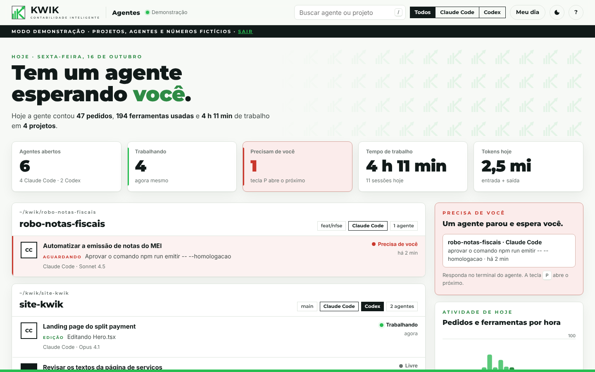
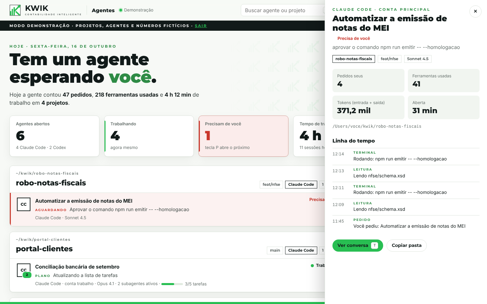
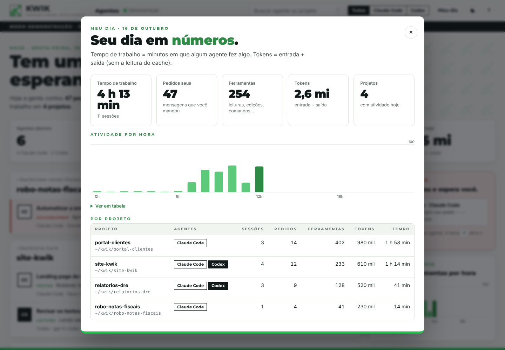
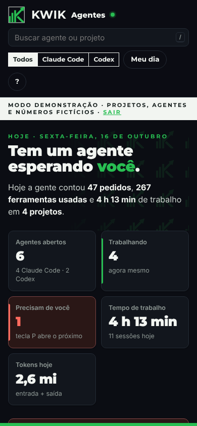

<p align="center">
  
</p>

<h1 align="center">KWIK Agentes</h1>

<p align="center">
  <b>Seus agentes de IA trabalhando, num painel com a cara da KWIK.</b><br />
  Veja ao vivo o que o Claude Code e o Codex estão fazendo, quem precisa de você e quanto rendeu o dia.
</p>

<p align="center"><b>https://kwik.localhost</b> · porta 5945 (K-W-I-K no teclado do telefone)</p>



---

Você abre o Claude Code num projeto, o Codex em outro, dispara subagentes… e perde a noção de quem está fazendo o
quê. O **KWIK Agentes** junta tudo numa tela só:

- **Cada projeto vira um cartão.** Cada sessão aparece dentro dele com o que está fazendo agora: lendo, editando,
  rodando testes, pesquisando.
- **Quem precisa de você aparece primeiro**, em vermelho, com o motivo: "aprovar o comando npm publish",
  "responder uma pergunta".
- **Meu dia:** tempo de trabalho, pedidos, ferramentas e tokens, por projeto e por hora.
- **Tudo local.** O painel só lê arquivos que o Claude Code e o Codex já gravam no seu computador. Nada sai daqui.

| Detalhes do agente | Meu dia | No celular |
| --- | --- | --- |
|  |  |  |

> As imagens usam o **modo demonstração** (`?mock=1`): projetos, agentes e números fictícios.

## Instalação em 1 passo

Cole o conteúdo de [`docs/PROMPT-INSTALACAO.md`](docs/PROMPT-INSTALACAO.md) no Claude Code ou no Codex. O agente
instala tudo sozinho (Docker, plugin, hooks e o endereço https://kwik.localhost) e só para para pedir permissão.

## Instalação manual

Precisa de **Node.js 22.12+**, **git** e **Docker** (Docker Desktop ou Docker Engine com Compose v2).

```bash
git clone https://github.com/SEU-USUARIO/kwik-agentes.git ~/kwik-agentes
cd ~/kwik-agentes
npm install                 # não baixa nada: o projeto não tem dependências

npm run docker:up           # acha as contas, monta só as pastas de sessões (somente leitura) e sobe na porta 5945
npm run claude:install      # liga o Claude Code (plugin kwik-agentes, em todas as contas)
npm run codex:install       # liga o Codex (hooks no hooks.json; depois aprove em /hooks, dentro do Codex)

npm install -g portless     # endereço bonito
portless alias kwik 5945
portless service install    # o proxy HTTPS sobe sozinho com o computador
```

Abra **https://kwik.localhost** (ou http://localhost:5945).

**Sem Docker:** `npm start` (ou `npm run dev`, que recarrega ao salvar).

## Como usar

| Atalho | O que faz |
| --- | --- |
| `/` | Buscar agente ou projeto |
| `P` | Abrir o próximo agente que precisa de você |
| `T` | Ver a conversa do agente aberto (somente leitura) |
| `M` | Meu dia |
| `D` | Tema claro ou escuro |
| `?` | Ajuda |
| `Esc` | Fechar |

**Estados:** **Trabalhando** (verde), **Precisa de você** (vermelho: permissão ou pergunta no terminal),
**Esperando comando** (terminou o turno, mas deixou um comando rodando) e **Livre**.
**CC** é Claude Code; **CX** (quadrado cheio) é Codex. O número verde no canto mostra subagentes ativos.

Sessões do Claude Code que já estavam abertas antes do `claude:install`: rode `/reload-plugins` nelas.

## Como funciona

| O quê | De onde vem (somente leitura) |
| --- | --- |
| Sessões abertas do Claude Code e o status (ocupado, livre, esperando você) | `<conta>/sessions/<pid>.json` |
| O que cada sessão fez, título, modelo, tokens, tarefas | `<conta>/projects/<pasta>/<sessão>.jsonl` |
| Subagentes ativos | `<conta>/projects/<pasta>/<sessão>/subagents/` |
| Sessões do Codex | `<CODEX_HOME>/sessions/AAAA/MM/DD/rollout-*.jsonl` |
| Aviso na hora (pedido, permissão, fim de turno) | hooks: plugin `kwik-agentes` (Claude Code) e `hooks.json` (Codex) |

- **Contas:** `~/.claude`, `~/.claude-*` e `CLAUDE_CONFIG_DIR`; `~/.codex`, `~/.codex-*` e `CODEX_HOME`.
- **No Docker**, o `docker:up` monta **só** `projects/` e `sessions/` de cada conta (e `sessions/` do Codex), em
  modo somente leitura. Credenciais (`.credentials.json`, `auth.json`, `.claude.json`) nunca entram no container.
- **Os hooks** só avisam o painel (`POST http://127.0.0.1:5945/api/events`, prazo de 1,2 s). Se o painel estiver
  fora do ar, o hook sai na hora e a sessão segue normal. Eles nunca aprovam nem recusam nada.
- **Segurança:** a porta fica só no `127.0.0.1`. O servidor recusa endereços que não sejam `localhost`,
  `*.localhost` ou IP (contra DNS rebinding) e esconde chaves e senhas óbvias antes de mostrar um comando.

### API

| Rota | O que devolve |
| --- | --- |
| `GET /api/health` | versão, contas lidas, último hook de cada agente, quantos agentes abertos |
| `GET /api/snapshot` | retrato atual: agentes, feed, números do dia |
| `GET /api/stream` | SSE: evento `snapshot` a cada mudança |
| `GET /api/agents/:id` | linha do tempo e tarefas |
| `GET /api/agents/:id/conversation` | conversa recente |
| `GET /api/day` | Meu dia, por projeto |
| `POST /api/events` | eventos dos hooks |

## Configuração

| Variável | Para quê |
| --- | --- |
| `KWIK_PORT` | outra porta (padrão 5945). Os hooks leem a porta de `~/.kwik/config.json`, gravado pelos instaladores |
| `KWIK_CLAUDE_DIRS` | pastas do Claude Code, separadas por vírgula (substitui a descoberta) |
| `KWIK_CODEX_DIRS` | pastas do Codex, separadas por vírgula |
| `KWIK_ALLOWED_HOSTS` | nomes extras aceitos no endereço, além de `localhost` e `*.localhost` |
| `KWIK_CLAUDE_BIN` | caminho do `claude`, se não estiver no PATH |

**Windows (WSL):** se o Claude Code ou o Codex rodam nativos no Windows, aponte as pastas pelo WSL antes do
`docker:up`: `KWIK_CLAUDE_DIRS=/mnt/c/Users/<você>/.claude npm run docker:up`. Nesse caso o painel acompanha pelos
arquivos (o status "precisa de você" do Claude Code vem do registro de sessões; o do Codex precisa dos hooks, que
só valem para o Codex rodando dentro do WSL).

## Manutenção

```bash
npm run claude:status && npm run codex:status   # tudo ligado?
npm run docker:logs                             # logs do painel
git pull && npm run docker:up && npm run claude:install   # atualizar
```

## Desinstalar

```bash
npm run claude:uninstall    # tira o plugin e o marketplace kwik de cada conta
npm run codex:uninstall     # tira só os hooks da KWIK (os outros ficam)
npm run docker:down
docker image rm kwik-agentes:local
portless alias --remove kwik
rm -rf ~/.kwik
```

## Solução de problemas

- **O painel abre, mas não aparece nenhum agente.** Confira `curl -s localhost:5945/api/health`: a lista
  `accounts` precisa ter as suas pastas. Se faltar alguma, use `KWIK_CLAUDE_DIRS`/`KWIK_CODEX_DIRS` e rode
  `npm run docker:up` de novo.
- **Linux: "permission denied" nos logs.** O `docker:up` roda o container com o seu usuário; rode-o com o mesmo
  usuário que usa o Claude Code (sem `sudo`).
- **"Precisa de você" do Codex não aparece.** Abra o Codex, digite `/hooks` e aprove os hooks da KWIK.
- **https://kwik.localhost não abre.** `portless list` deve mostrar `kwik.localhost -> localhost:5945`. Se o
  navegador reclamar do certificado, rode `portless trust`.
- **Testes:** `npm test`.

## Créditos

Inspirado no [Habblaud](https://github.com/marmottajr/habblaud), o escritório em pixel art dos agentes do Claude
Code. Fontes Montserrat e Inter (SIL Open Font License, em `public/fonts`). Identidade visual: Manual da Marca KWIK,
edição 2026.
